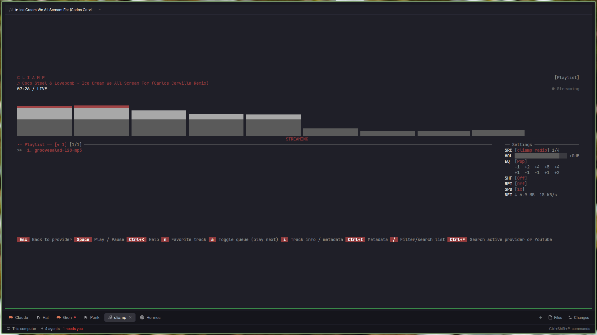

Last month I gave up on herdr. It was the TUI version, and I just wasn't happy with the look and feel.

This month it opens when I log in.

[herdr](https://herdr.dev) is a home for AI agents. What changed my mind was the new desktop app. Same idea, far more polished and a lot less terminal, which suits a modern desktop like mine: tabs along the bottom, an agent in each one, and a status line that tells you what they're up to.

Yes, that's a music player. We'll get to it.

## The Actual Problem

One agent in a terminal is easy. Two is fine. Somewhere around three you start losing track.

One has finished and is sitting there quietly. Another stopped ten minutes ago to ask permission for something, and you didn't notice because you were looking at a different window. You end up cycling through terminals like a night watchman checking doors.

The most useful thing in that screenshot is the small text at the bottom left: **4 agents, 1 needs you**. That's it. That's the feature. I can get on with something else and only look when somebody wants me.

## Who's In The Tabs

- **Claude** does the real work: coding, decisions, anything I'd be annoyed to see done badly
- **Hal** runs in pi on a cloud model and takes the bulky reading and research
- **Gron** is Claude Sonnet, for reviews and second opinions
- **Ponk** is Claude Haiku, for quick lookups and light drafts
- **Hermes** is my always-on agent, running on a small server in the house
- **cliamp** is not an agent. It plays Groove Salad.

The names are silly. They're also much easier to shout at than "terminal 3".

You don't need any of this to start. Two tabs is a perfectly good setup: one agent doing the work, one checking it. Mine grew a tab at a time, mostly because I kept thinking "could something cheaper read that for me?"

## One Rule Worth Stealing

The helpers are read-only, and that's enforced rather than politely requested. I learned that one properly when a small model with a clear instruction not to write files went ahead and wrote files.

They can read, search and report back. Anything that changes the system goes through the main session where I can see it. It also makes the whole thing far less nerve-racking. A helper having a bad day wastes a few minutes rather than my config.

## Is It Worth It

It's young software. The app is at 0.1.x, I update it by hand from the AUR, and it took some fiddling to get the tabs coming back properly after a login. Claude did most of that wiring. Deciding who does what, and what none of them are allowed to touch, stayed with me.

But running several agents turned out to be less of a sysadmin project and more like keeping a few browser tabs open, except these ones tap you on the shoulder.

I dropped it over the looks. Now it looks the part, and it's got a radio in it.
